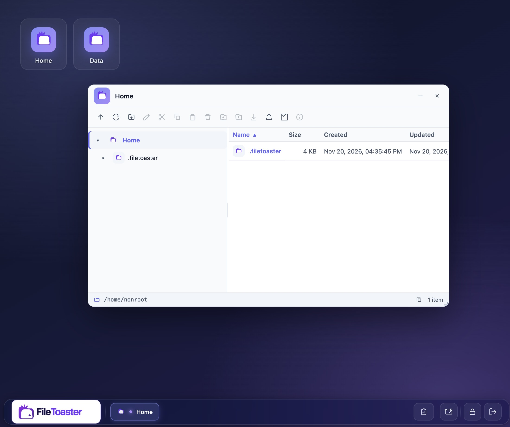

<p align="center">
  
</p>

<h1 align="center">FileToaster</h1>

<p align="center">
  <strong>Fast, beautiful, multi-window file manager for self-hosted setups and homelabs</strong>
</p>

<p align="center">
  <a href="#features-goals"><strong>Features</strong></a> •
  <a href="#limitations"><strong>Limitations</strong></a> •
  <a href="#docker-docker-run"><strong>Docker</strong></a> •
  <a href="#other-installation-methods"><strong>Install</strong></a> •
  <a href="#configuration"><strong>Config</strong></a> •
  <a href="#security"><strong>Security</strong></a> •
  <a href="#license"><strong>License</strong></a>
</p>

---

## Screenshot



---

## Table of Contents

- [Features & Goals](#features-goals)
- [Limitations](#limitations)
- [Docker & Docker Run](#docker-docker-run)
- [Other Installation Methods](#other-installation-methods)
- [Configuration](#configuration)
  - [Config File Parameters](#config-file-parameters)
  - [Config File Example](#config-file-example)
  - [Environment Variable Overrides](#environment-variable-overrides)
- [Change Password Caveat](#change-password-caveat)
- [Show Your Support](#show-your-support)
- [Security](#security)
- [License](#license)

---

## Features & Goals

FileToaster is a modern, self-hosted file manager built for homelabs and personal infrastructure. It combines a beautiful SvelteKit frontend with a high-performance Go backend, all packaged as a single embedded binary.

| Feature | Description |
|---------|-------------|
| **Multiple Roots** | Configure multiple root directories via `allowed_paths` in config YAML or environment variables. Each root appears as a folder icon on the desktop. |
| **Fast & Beautiful** | SvelteKit + TailwindCSS frontend with smooth animations, draggable/resizable windows, and a polished desktop-like experience. |
| **Multi-Window** | Open many file manager windows side-by-side. Each window maintains its own navigation state and selection. |
| **Asynchronous Tasks** | All file operations (copy, move, delete, compress, decompress, upload, download) run as tracked background tasks with real-time progress via SSE. |
| **Task Management** | Live task panel shows queued/running tasks with progress bars, transfer rates, file counts, and cancel controls. Tasks survive browser refresh. |
| **Jump to Path** | Type or paste any absolute path directly into the taskbar to navigate instantly — no clicking through folder trees required. |
| **Drag & Drop** | Intra-window drag-and-drop for copy/move between open windows with explicit mode selection dialog. |
| **Upload & Download** | Chunked, resumable uploads with drag-and-drop (files) and folder picker (toolbar). Single-file streaming downloads with one-time tokens. |
| **Compression/Decompression** | Create and extract `.zip`, `.tar`, `.tar.gz`/`.tgz` archives as tracked async tasks with zip-slip protection. |
| **Keyboard Shortcuts** | Full keyboard navigation (arrows, modifiers) plus shortcuts for all actions (`?` to show overlay). |
| **Context Menus** | Right-click anywhere for contextual actions — folder, file, multi-selection, and empty space each get relevant menus. |
| **Information Panel** | Get detailed metadata (recursive size, file/dir counts, permissions, timestamps) for any selection. |
| **Self-Hosted Friendly** | Single binary, no database, config via YAML + env vars, runs as non-root, perfect for homelabs and containers. |

---

## Limitations

- **Large Directories**: Very large numbers of files or directories (hundreds of thousands+) may hit performance limits in directory listing and tree rendering.
- **No Database**: All task state is in-memory and resets on server restart (by design for simplicity).
- **Compression Formats**: Only stdlib-supported formats (zip, tar, tar.gz). No bz2, xz, lz4, zstd, rar, 7z, or standalone `.gz`.
- **Single-User**: Designed for single-admin use; no multi-user support or ACLs.

---

## Docker & Docker Run

The container uses Alpine Linux with a flexible entrypoint that supports the **PUID/PGID** pattern. By default it runs as UID:GID **65532** (the standard nonroot user), but you can override this to run as your host user.

### Quick Start (default nonroot user)

```bash
docker run -d \
  --name filetoaster \
  -p 8080:8080 \
  ghcr.io/zeeshanabid/filetoaster:latest
```

### Run as Your Host User (recommended for bind mounts)

Pass `PUID` and `PGID` to match your host user — this makes bind-mounted volumes directly writable without permission issues:

```bash
docker run -d \
  --name filetoaster \
  -p 8080:8080 \
  -e PUID="$(id -u)" \
  -e PGID="$(id -g)" \
  -e FILETOASTER_SESSION_SECRET="$(openssl rand -hex 32)" \
  -e FILETOASTER_ADMIN_PASSWORD="changeme" \
  -v /path/to/your/data:/data \
  -v "/home/$(whoami)/.filetoaster":"/home/filetoaster/.filetoaster" \
  ghcr.io/zeeshanabid/filetoaster:latest
```

### Persistent Config with Named Volume

Use a Docker named volume for config/upload staging (managed by Docker with correct permissions):

```bash
docker run -d \
  --name filetoaster \
  -p 8080:8080 \
  -v /mnt/data:/data \
  -v filetoaster-config:/home/filetoaster/.filetoaster \
  -e FILETOASTER_SESSION_SECRET="$(openssl rand -hex 32)" \
  -e FILETOASTER_ADMIN_PASSWORD="changeme" \
  ghcr.io/zeeshanabid/filetoaster:latest
```

### Default Credentials

| Field | Default |
|-------|---------|
| Username | `admin` |
| Password | `admin` (change immediately via **Change Password** in UI or set `FILETOASTER_ADMIN_PASSWORD`) |

> **⚠️ Important**: If you **don't** pass `PUID`/`PGID`, the container runs as UID:GID **65532:65532** (the built-in nonroot user). Ensure your mounted volumes are writable by this user, or use the `PUID`/`PGID` override above to match your host user.

---

## Other Installation Methods

### Build from Source

```bash
# Prerequisites: Go 1.27+, Node 18+, make
git clone https://github.com/zeeshanabid/FileToaster.git
cd FileToaster

# Build everything (frontend + embedded Go binary)
make build

# Run the binary
export PATH=/usr/local/go/bin:$PATH GOTOOLCHAIN=local
FILETOASTER_SESSION_SECRET="$(openssl rand -hex 32)" ./server/bin/server
```

The binary will be at `server/bin/server` (or `server/bin/filetoaster` in Docker build).

---

## Configuration

### Config File Resolution Order

1. `--config-file <path>` CLI flag
2. `FILETOASTER_CONFIG` environment variable
3. `./config.yaml` (current working directory)
4. `~/.filetoaster/config.yaml` (auto-created on first run if none exist)

### Config File Parameters

| Parameter | Type | Required | Description |
|-----------|------|----------|-------------|
| `addr` | string | No | Bind address (default `:8080`) |
| `allowed_paths` | array | **Yes** | List of root directories to serve |
| `allowed_paths[].name` | string | **Yes** | Display name for the root |
| `allowed_paths[].path` | string | No* | Absolute path to the root |
| `allowed_paths[].env` | string | No* | Env var containing absolute path |
| `max_parallel_tasks` | int | No | Concurrent task limit (default 4) |
| `shutdown_timeout_seconds` | int | No | Graceful shutdown deadline (default 30) |
| `debug` | bool | No | Enable debug logging (default false) |
| `gomaxprocs` | int | No | GOMAXPROCS value (default 0 = runtime) |
| `tmp_dir` | string | No | Upload staging directory (default `~/.filetoaster/tmp_uploads`) |
| `upload_chunk_size` | int | No | Chunk size in bytes (default 4194304 = 4 MiB) |
| `upload_max_concurrent_chunks` | int | No | Global concurrent chunk limit (default 4) |
| `upload_stale_after` | int | No | Hours before staged upload cleanup (default 24) |
| `upload_sweep_interval` | int | No | Sweep interval in hours (default 1) |
| `session_secret` | string | **Yes** | HMAC secret for session cookies |
| `admin_user` | string | No | Admin username (default `admin`) |
| `admin_password_hash` | string | No | Argon2id hash (overridden by env) |

*At least one of `path` or `env` must be set per entry. `path` takes precedence if both present.

### Config File Example

```yaml
# FileToaster configuration
# Copy to config.yaml and adjust

addr: ":8080"

allowed_paths:
  - name: Documents
    path: /data/documents
  - name: SharedDrive
    env: SHARED_DRIVE_PATH
  - name: Root
    path: /

max_parallel_tasks: 4
shutdown_timeout_seconds: 30
debug: false
gomaxprocs: 0

tmp_dir: /home/nonroot/.filetoaster/tmp_uploads
upload_chunk_size: 4194304
upload_max_concurrent_chunks: 4
upload_stale_after: 24
upload_sweep_interval: 1

session_secret: "change-me-in-production"
admin_user: admin
admin_password_hash: ""  # Set via FILETOASTER_ADMIN_PASSWORD env var
```

### Environment Variable Overrides

All config parameters (except `admin_password_hash`, `admin_user`, `session_secret`) can be overridden via environment variables:

| Config Parameter | Environment Variable |
|------------------|---------------------|
| `addr` | `FILETOASTER_ADDR` |
| `max_parallel_tasks` | `FILETOASTER_MAX_TASKS` |
| `shutdown_timeout_seconds` | `FILETOASTER_SHUTDOWN_TIMEOUT` |
| `debug` | `FILETOASTER_DEBUG` |
| `gomaxprocs` | `FILETOASTER_GOMAXPROCS` |
| `tmp_dir` | `FILETOASTER_TMP_DIR` |
| `upload_chunk_size` | `FILETOASTER_UPLOAD_CHUNK_SIZE` |
| `upload_max_concurrent_chunks` | `FILETOASTER_UPLOAD_MAX_CONCURRENT_CHUNKS` |
| Config file path | `FILETOASTER_CONFIG` |

**Required**: `FILETOASTER_SESSION_SECRET` must be set via environment variable.

**Optional**: `FILETOASTER_ADMIN_PASSWORD` — when set, takes precedence over `admin_password_hash` in config and the default `admin` password.

---

## Change Password Caveat

> **⚠️ Important**: If `FILETOASTER_ADMIN_PASSWORD` is set in the environment, the **Change Password** feature in the UI will **not** override it. The environment variable always takes precedence at runtime. To change the password when using the env var, update the environment variable and restart the container/server.

---

## Show Your Support

If FileToaster helps you manage your files, please consider giving it a star!

[](https://github.com/zeeshanabid/FileToaster/stargazers)

---

## Security

If you discover a security vulnerability, please report it **privately** via GitHub Security Advisories instead of using the public issue tracker:

👉 **[https://github.com/zeeshanabid/FileToaster/security/advisories](https://github.com/zeeshanabid/FileToaster/security/advisories)**

---

## License

Copyright (c) 2026 Zeeshan Abid.

This project is **MIT licensed**. See [LICENSE](LICENSE) for details.

---

<p align="center">
  Made with ❤️ for homelabs and self-hosters everywhere.
</p>